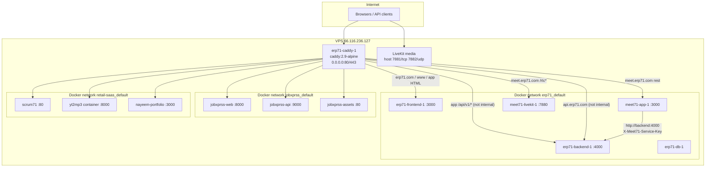
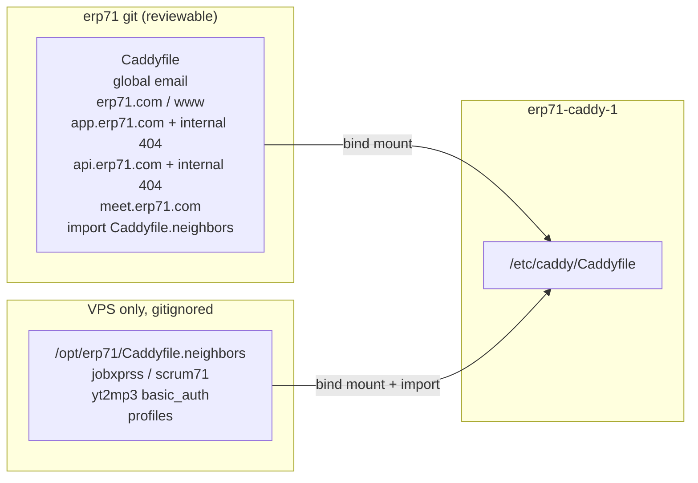
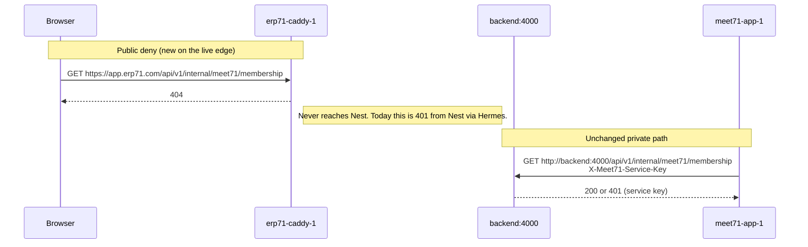
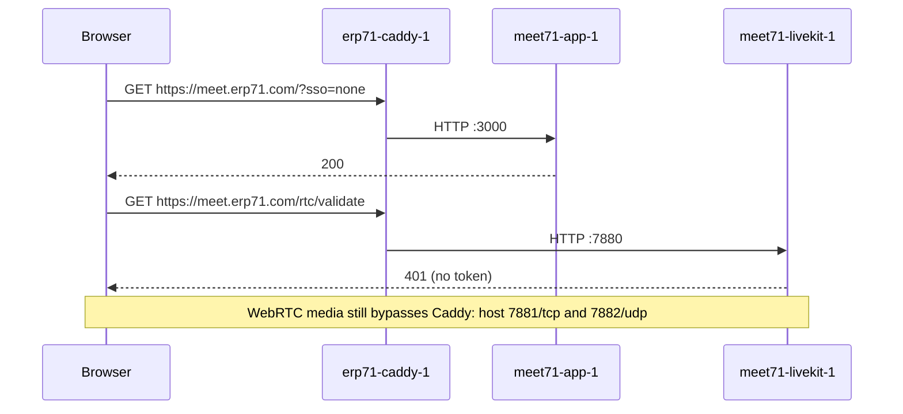

# Replace Hermes with ERP71's Own Caddy on the Shared VPS

| Field | Value |
|---|---|
| **Author** | ERP71 / Meet71 engineering |
| **Date** | 2026-11-01 |
| **Status** | Draft |
| **Repos** | [`nayeem-ahmad/erp71`](https://github.com/nayeem-ahmad/erp71), [`nayeem-ahmad/meet71`](https://github.com/nayeem-ahmad/meet71) |
| **Production host** | `root@66.116.236.127` (`/opt/erp71`, `/opt/meet71`) |

---

## Overview

The shared VPS still publishes every public hostname through Hermes: `hermes-webui-proxy` (Caddy 2.9) binds `0.0.0.0:80` and `:443`, and `hermes-gateway.service` listens on `172.18.0.1:19090`. ERP71 already has a production-ready Caddy service in [`docker-compose.prod.yml`](/Users/bs01621/Projects/nayeem/erp71/docker-compose.prod.yml) (`caddy:2.9-alpine`, profile `standalone-edge`) and an in-repo [`Caddyfile`](/Users/bs01621/Projects/nayeem/erp71/Caddyfile) that 404s `/api/v1/internal/*`. That in-repo file is not the public edge today, so Meet71's internal ERP71 APIs remain reachable from the internet (Nest returns 401). Hermes also owns neighbor apps (JobXprss, Scrum71, yt2mp3, profiles) and three hostnames we are retiring.

This design makes ERP71's compose `caddy` service the only public reverse proxy. The in-repo Caddyfile serves ERP71 + Meet71 (including the internal-API 404). Neighbor site blocks, including the yt2mp3 bcrypt hash, stay on the VPS at `/opt/erp71/Caddyfile.neighbors` and are `import`ed, never committed. Hermes proxy, static UI, and gateway are stopped. `MEET71_ERP71_SSO` stays off; the cutover is what makes the in-repo 404 actually hit the public internet.

---

## Background & Motivation

### Current public edge (verified 2026-11-01)

| Piece | Live fact |
|---|---|
| Proxy | `hermes-webui-proxy` (`caddy:2.9-alpine`) on `0.0.0.0:80` and `:443` |
| Static UI | `hermes-webui-static` (Hermes Web UI for `ai.nayeemahmad.com`) |
| Agent | `hermes-gateway.service` (systemd, `hermes` on `172.18.0.1:19090`) |
| Config | `/opt/hermes/caddy/Caddyfile` (105 lines) |
| Networks | `erp71_default`, `jobxprss_default`, `retail-saas_default` |
| Upstreams | **Container names** (`erp71-frontend-1`, `meet71-app-1`, `jobxprss-web`, …) |

ERP71's in-repo Caddyfile uses **compose service names** (`frontend`, `backend`) because Caddy is meant to sit in the same compose project. It is gated behind `profiles: [standalone-edge]`, so [`scripts/deploy.sh`](/Users/bs01621/Projects/nayeem/erp71/scripts/deploy.sh) never starts it. Instead `attach_caddy()` reconnects `hermes-webui-proxy` / `hermes-caddy-1` to `erp71_default` after every deploy.

Meet71 [`scripts/deploy.sh`](/Users/bs01621/Projects/nayeem/meet71/scripts/deploy.sh) `configure_caddy()` finds that same Hermes container, bind-mount-edits `/opt/hermes/caddy/Caddyfile` in place, `caddy validate`s, and reloads. The `meet.erp71.com` block is marked `# meet71: managed by /opt/meet71/scripts/deploy.sh`.

### Pain points

1. **Two sources of truth.** Production routing lives in Hermes; the repo Caddyfile is a parallel copy that can (and does) drift. The internal-API 404 is in git and **not** in Hermes, so `https://app.erp71.com/api/v1/internal/meet71/membership` is a 401 from Nest, not a 404 from the edge.
2. **Meet71 deploys mutate a file that serves five other apps.** A bad reload takes JobXprss and Scrum71 down with Meet71. The Meet71 script already documents this.
3. **Hermes is leftover platform, not a product we run.** `ai.nayeemahmad.com`, `app.nayeemahmad.com` (301 → `app.erp71.com`), and `api.nayeemahmad.com` (301 → `api.erp71.com`) are the last Hermes-only sites. The gateway on `:19090` is unused by ERP71/Meet71.
4. **SSO is blocked on the missing deny.** Meet71 `TODO.md` item 7 and the SSO spec both refuse to set `MEET71_ERP71_SSO=1` until the public edge 404s `/api/v1/internal/*`. This cutover is that edge change. Enabling SSO is a follow-up, not this work.

### What stays the same

- Compose projects, Postgres, LiveKit host ports `7881/tcp` and `7882/udp`.
- Meet71 still joins `erp71_default` and does not bind 80/443.
- Production schema is unchanged. No Prisma. No feature-flag flips.

---

## Goals & Non-Goals

### Goals

1. ERP71 compose service `caddy` is the only process bound to host 80/443.
2. Public hostnames that must keep working keep working, with the same routing they have today (see hostname table).
3. In-repo [`Caddyfile`](/Users/bs01621/Projects/nayeem/erp71/Caddyfile) is what production loads for ERP71 + Meet71, including `@meet71internal` → 404 on `app.erp71.com` and `api.erp71.com`.
4. Neighbor site blocks (JobXprss, Scrum71, yt2mp3 `basic_auth`, profiles) live only on the VPS and are imported, not committed.
5. Hermes stack is gone: stop/remove `hermes-webui-proxy` and `hermes-webui-static`; stop and disable `hermes-gateway.service`.
6. Copy Caddy certificate data so Let's Encrypt is not re-issued for every hostname.
7. Rollback path: restore Hermes proxy + gateway if ERP71 Caddy fails health checks.
8. Additive docs in erp71 `docs/ops/deployment-runbook.md` and meet71 `CLAUDE.md` / `README.md` / `deploy.sh` comments.
9. Brief public blip on 80/443 during cutover is acceptable; neighbor apps must come back.

### Non-Goals

- Enabling `MEET71_ERP71_SSO=1` or `MEET71_CREATOR_ADMIT=1`.
- Committing JobXprss / Scrum71 / yt2mp3 / profiles routing, or the yt2mp3 bcrypt hash, to the ERP71 git repo.
- Keeping `ai.nayeemahmad.com`, `app.nayeemahmad.com`, or `api.nayeemahmad.com` alive.
- Changing LiveKit media ports, Meet71 compose, or ERP71 application code.
- Prisma / schema / database work.
- Building a generic multi-tenant edge platform. This is a VPS cutover.
- Deleting Hermes files or Docker volumes on day one (needed for rollback).
- Rewriting `scripts/deploy-erp71.sh` / `scripts/migrate-vps-rename.sh` (legacy, unused by current deploys).

---

## Key Decisions

1. **ERP71 compose Caddy becomes the public edge; `standalone-edge` is a same-night fuse, not a multi-day one.** Leaving the profile in place until after a successful cutover means an accidental `dev`→`main` merge cannot bind 80/443 while Hermes still holds those ports. **Meet71 PR 2 (stop mutating Hermes) is a hard prerequisite for the VPS night** — today's `configure_caddy()` `exit 1`s if `hermes-webui-proxy` / `hermes-caddy-1` are gone, so a Meet71 push during soak would go red even with healthy app containers. After Caddy is up with `--profile standalone-edge`, freeze ERP71 `dev`→`main` until **PR 3 is on `main` and the first post-PR-3 deploy has reloaded Caddy and shown the extra nets on `erp71-caddy-1`**. Prefer merging PR 3 the same night. In the fuse window, `compose up -d` *without* the profile leaves the profiled Caddy running (not an orphan) but does **not** reload the Caddyfile, recreate on a stale inode, or reconnect extra networks — a manual `--force-recreate` in that window silently drops neighbor DNS. Do not leave that window open overnight. Rollback after PR 3 must restore the profile on **`origin/main`** (revert PR 3, or a follow-up commit that re-adds `profiles: [standalone-edge]`) **and** freeze/disable GitHub Actions "Deploy to VPS" until Hermes is up and `compose up -d` no longer creates `erp71-caddy-1`. A VPS-only `git checkout` of the pre-PR-3 commit is **not** a rollback — the next auto-deploy still runs `scripts/deploy.sh` from `origin/main` and crash-loops Caddy against Hermes' ports.

2. **Split the Caddyfile: git owns ERP71 + Meet71; the VPS owns neighbors.** Meet71 is first-party on `meet.erp71.com` and already described in ERP71's runbook, so its site block belongs in git. JobXprss, Scrum71, yt2mp3 (bcrypt), and profiles are other apps / secrets and stay in `/opt/erp71/Caddyfile.neighbors`. The in-repo Caddyfile ends with `import Caddyfile.neighbors`. **Pre-cutover** (profile on): `deploy.sh` writes a comment-only stub if the file is missing, so a missing bind-mount cannot become a Docker directory and `import` of a specific missing file cannot crash an experimental `--profile` start. **Post-cutover (PR 3):** if the file is missing, a directory, or has no site blocks, **fail the deploy and do not reload**. A stub after Caddy is the edge would silently drop JobXprss / Scrum71 / yt2mp3 / profiles and lose the bcrypt. Cutover copies the neighbors file to `/root/caddy-cutover-$TS-neighbors.bak` — after Hermes is `docker rm`'d that backup is the only extra copy of the hash.

3. **Same-project upstreams use compose service names; cross-project upstreams use container names.** In-repo Caddyfile keeps `frontend:3000` / `backend:4000`. Meet71 is compose project `meet71` on the external network `erp71_default`, so the Meet71 block uses `meet71-app-1:3000` and `meet71-livekit-1:7880` — the same names Hermes uses, and unambiguous if a future ERP71 service is named `app`. Neighbor blocks are copied verbatim from live Hermes, not rewritten to guessed service names (`yt2mp3-yt2mp3-1` vs `yt2mp3`, two portfolio containers).

4. **Do not declare neighbor Docker networks as required `external:` networks in `docker-compose.prod.yml`.** Those nets exist on this VPS and not on a dedicated ERP71 host. At cutover, inspect Hermes' networks (`docker inspect hermes-webui-proxy --format '{{range $k,$v := .NetworkSettings.Networks}}{{$k}} {{end}}'`), attach `erp71-caddy-1` to that set minus `bridge`/`host`, and persist the extra names (not `erp71_default`) to `/opt/erp71/caddy-extra-networks`. `deploy.sh` and every Caddy recreate re-read that file and `docker network connect`. Do not hard-code `jobxprss_default` / `retail-saas_default` as the only extras — a fourth net or a rename 502s. Extra nets do **not** survive `compose up --force-recreate caddy`. Missing extra networks warn and do not fail an ERP71 deploy (Meet71 down is the same: ERP71 health stays green).

5. **Copy Hermes `/data` (certs + ACME account) into a clean `erp71_caddy_data`; do not copy `/config`.** Same image (`caddy:2.9-alpine`) so the storage format matches. Copying autosave JSON from Hermes would reload the old site list (including hostnames we are dropping). Official image is `caddy run --config /etc/caddy/Caddyfile --adapter caddyfile` (no `--resume`); Caddyfile + `/data` is the intended pair. If `erp71_caddy_data` already exists and is non-empty (a prior `--profile standalone-edge` experiment), inspect it; if it is not a copy of Hermes `/data`, `docker volume rm` it **only while Caddy is not running** and recreate before `cp -a`. Copy while Hermes is still serving (right blip tradeoff); Caddy may hold lock files under `/data/caddy` — copy anyway, then confirm `certificates/` and `acme/` exist. Diff Hermes' global `email` against the in-repo `{ email nayeem.ahmad@gmail.com }` in step 0; a mismatch can register a new ACME account and re-issue. Duplicate-cert limit is still 5/week/exact-name set; copy remains the plan.

6. **Meet71 stops mutating the edge Caddyfile, and that change ships before cutover.** After this work the `meet.erp71.com` block lives in ERP71 git. Meet71 `configure_caddy()` becomes a public health check only. PR 2 is behaviour-safe *against current Hermes* (the block already exists, so 200/401 stay green) and is **required on Meet71 `main` before the VPS night**, not optional. Freeze Meet71 merges from "validate neighbors" until cutover health checks pass.

7. **Do not flip `MEET71_ERP71_SSO`.** The 404 going live is an intentional security improvement and the SSO prerequisite. Enabling SSO is a separate ops decision after confirming the 404.

8. **Keep Hermes containers and volumes until a soak period (7 days) succeeds.** Rollback is "stop/rm `erp71-caddy-1` (it is `unless-stopped` / may be `Restarting`), wait until 80/443 are free, start Hermes, reconnect the **inspected** Hermes nets, `systemctl enable --now hermes-gateway.service`," not a rebuild. `docker rm` of Hermes / `docker volume rm` wait until soak. Never `docker rm -v` during rollback — keep `erp71_caddy_data`. After PR 3, rollback restores the `standalone-edge` profile on **`origin/main`** (revert PR 3 or a follow-up that re-adds the profile) and freezes/disables Deploy to VPS **before** Hermes is started. A VPS-only checkout leaves `origin/main` on PR 3; the next auto-deploy binds Caddy again.

9. **Retired `*.nayeemahmad.com` names are absent from both Caddyfiles; unknown SNI is not a stub site.** `ai.nayeemahmad.com`, `app.nayeemahmad.com`, and `api.nayeemahmad.com` go down by omission, not a dummy block and not a kept 301. Keeping the two 301s as three-line `redir` blocks in git would be bookmark-safe and secret-free; product is that those hostnames go down, so we do not add them. Without `on_demand_tls`, Caddy will not issue for unknown SNI — clients typically get a TLS handshake error (`no certificate available`), not HTTP 404. A **200 with a default site or a leftover 301 to erp71** at cutover means the neighbors extract failed to omit; that is a rollback, not "fine".

10. **Do not publish `443/udp` unless live Hermes already did.** Hermes binds TCP 80/443 only. HTTP/3 would be a behaviour change, not a cutover requirement. Brief public blip from stop-then-bind is accepted; no systemd/`SO_REUSEPORT` port handoff.

---

## Proposed Design

### Target topology



Hermes (`hermes-webui-proxy`, `hermes-webui-static`, `hermes-gateway.service`) is absent from the target.

### Hostname matrix

| Hostname | After cutover | Upstream | Config lives in |
|---|---|---|---|
| `erp71.com`, `www.erp71.com` | Keep | `frontend:3000` | git `Caddyfile` |
| `app.erp71.com` | Keep | `/api/v1/internal/*` → 404; `/api/v1/*` → `backend:4000` (`flush_interval -1`); else `frontend:3000` | git `Caddyfile` |
| `api.erp71.com` | Keep | `/api/v1/internal/*` → 404; else `backend:4000` | git `Caddyfile` |
| `meet.erp71.com` | Keep | `/rtc*` → `meet71-livekit-1:7880`; else `meet71-app-1:3000` | git `Caddyfile` |
| `scrum71.nayeemahmad.com` | Keep | `scrum71:80` (copy live Hermes name) | VPS `Caddyfile.neighbors` |
| `app.jobxprss.com` | Keep | `jobxprss-web:8000` | VPS `Caddyfile.neighbors` |
| `api.jobxprss.com` | Keep | `/static`+`/media` → `jobxprss-assets:80`; else `jobxprss-api:9000` | VPS `Caddyfile.neighbors` |
| `yt2mp3.erp71.com` | Keep | `yt2mp3…:8000` + existing `basic_auth` | VPS `Caddyfile.neighbors` |
| `profiles.erp71.com` | Keep | `nayeem-portfolio…:3000` (copy live Hermes name) | VPS `Caddyfile.neighbors` |
| `ai.nayeemahmad.com` | **Down** | — | omitted |
| `app.nayeemahmad.com` | **Down** (was 301 → `app.erp71.com`) | — | omitted |
| `api.nayeemahmad.com` | **Down** (was 301 → `api.erp71.com`) | — | omitted |

Live Hermes uses container names. The neighbors file is **copied from `/opt/hermes/caddy/Caddyfile`**, not retyped. Two portfolio containers exist on `retail-saas_default` (`profiles71-nayeem-portfolio-1` and `nayeem-ahmad-portfolio-nayeem-portfolio-1`); yt2mp3's compose name is `yt2mp3-yt2mp3-1`. Guessing will 502.

### Caddyfile split



In-repo Caddyfile after this work (additive; existing ERP71 blocks unchanged):

```caddy
{
    email nayeem.ahmad@gmail.com
}

erp71.com, www.erp71.com {
    encode zstd gzip
    reverse_proxy frontend:3000
}

app.erp71.com {
    encode zstd gzip
    @meet71internal path /api/v1/internal/*
    handle @meet71internal {
        respond 404
    }
    handle /api/v1/* {
        reverse_proxy backend:4000 {
            flush_interval -1
        }
    }
    handle {
        reverse_proxy frontend:3000
    }
}

api.erp71.com {
    encode zstd gzip
    @meet71internal path /api/v1/internal/*
    handle @meet71internal {
        respond 404
    }
    handle {
        reverse_proxy backend:4000
    }
}

# Meet71 (compose project meet71 on erp71_default). Container names, not
# service names: Caddy is in project erp71, so `app` would be ambiguous.
meet.erp71.com {
    handle /rtc* {
        reverse_proxy meet71-livekit-1:7880
    }
    handle {
        encode zstd gzip
        reverse_proxy meet71-app-1:3000
    }
}

# Neighbor apps. File is gitignored and lives only on the VPS.
# Pre-cutover deploy.sh may write a comment-only stub; after Caddy is the
# edge, a missing/empty file fails the deploy (see ensure_neighbors_file).
import Caddyfile.neighbors
```

`import` is relative to the Caddyfile's directory inside the container (`/etc/caddy`). Both files are mounted into that directory.

Neighbors file (illustrative; **live text is copied from Hermes**, bcrypt not shown, not committed):

```caddy
# /opt/erp71/Caddyfile.neighbors — not in git. chmod 600.
# Copied from /opt/hermes/caddy/Caddyfile at cutover. Do not retype upstreams.

scrum71.nayeemahmad.com {
    encode zstd gzip
    reverse_proxy scrum71:80
}

app.jobxprss.com {
    encode zstd gzip
    reverse_proxy jobxprss-web:8000
}

api.jobxprss.com {
    encode zstd gzip
    handle /static* {
        reverse_proxy jobxprss-assets:80
    }
    handle /media* {
        reverse_proxy jobxprss-assets:80
    }
    handle {
        reverse_proxy jobxprss-api:9000
    }
}

yt2mp3.erp71.com {
    encode zstd gzip
    basic_auth {
        # bcrypt hash copied from live Hermes Caddyfile — never commit
        USER HASH
    }
    reverse_proxy <live-container-name>:8000
}

profiles.erp71.com {
    encode zstd gzip
    reverse_proxy <live-container-name>:3000
}
```

Path matchers for JobXprss `/static` and `/media` must match Hermes exactly (`/static*` vs `/static` vs `/static/`). Copy, then `caddy validate`.

`.gitignore` addition:

```
# VPS-only neighbor site blocks (bcrypt, other-app coupling)
/Caddyfile.neighbors
# Extra docker networks to attach after every Caddy recreate (written at cutover)
/caddy-extra-networks
```

### Compose changes

[`docker-compose.prod.yml`](/Users/bs01621/Projects/nayeem/erp71/docker-compose.prod.yml) today:

```yaml
  caddy:
    image: caddy:2.9-alpine
    profiles:
      - standalone-edge
    depends_on:
      - frontend
      - backend
    ports:
      - "80:80"
      - "443:443"
    volumes:
      - ./Caddyfile:/etc/caddy/Caddyfile:ro
      - caddy_data:/data
      - caddy_config:/config
    restart: unless-stopped
```

**PR 1 (pre-cutover, mergeable, no port conflict):** keep the profile; add the neighbors bind-mount; do not add `jobxprss_default` / `retail-saas_default` as compose `external` networks.

```yaml
    volumes:
      - ./Caddyfile:/etc/caddy/Caddyfile:ro
      - ./Caddyfile.neighbors:/etc/caddy/Caddyfile.neighbors:ro
      - caddy_data:/data
      - caddy_config:/config
```

Do **not** publish `443/udp` unless live Hermes already did (it binds TCP 80/443 only). Do not add a Caddy healthcheck that needs `curl`/`wget`; the official `caddy:2.9-alpine` image has neither. Health is host-side `curl` of public URLs, which is what deploy already does.

**PR 3 (post-cutover):** delete `profiles: [standalone-edge]` and the comment that says a shared Hermes proxy owns 80/443. After that, `compose up -d` starts Caddy.

`depends_on: [frontend, backend]` stays. Caddy must not `depends_on` Meet71 or neighbor containers; a Meet71 outage must not block ERP71 deploys (same as today).

### ERP71 `scripts/deploy.sh`

Two phases, matching the PRs. Both files are single-file bind mounts (`./Caddyfile` and `./Caddyfile.neighbors`). Git checkout, `sed -i`, `nano`, some `vim` backups, and editor rename-writes replace the inode; `caddy reload` then validates/reloads the **stale** copy inside the container. Meet71's Hermes script already defends this with `docker exec … cat | cmp`. Apply that to **both** mounts. Operators must write neighbors in place (`cat >file` / `tee`, never `mv` a replacement over the path); document that in `shared-vps-second-app.md`.

**While Hermes is still the edge (PR 1):** keep `attach_caddy()` for `hermes-webui-proxy` / `hermes-caddy-1`. Add `ensure_neighbors_file()` in **stub mode** so the gitignored bind-mount is always a file:

```bash
# PR 1: stub mode. PR 3 replaces the missing-file branch with fail-closed.
ensure_neighbors_file() {
  local f="$REPO_ROOT/Caddyfile.neighbors"
  if [ -d "$f" ]; then
    echo "ERROR: $f is a directory. Docker creates that when the bind mount" >&2
    echo "is missing; remove it and re-run. Neighbor config lives on the VPS." >&2
    exit 1
  fi
  if [ ! -f "$f" ]; then
    printf '# Neighbor site blocks. Not in git. See docs/ops/deployment-runbook.md.\n' > "$f"
    chmod 600 "$f"
  fi
}
```

Call it before any `compose up` that might start Caddy. Harmless while the profile is off.

**After Caddy is the edge (PR 3):**

1. Remove Hermes `attach_caddy()`.
2. `ensure_neighbors_file()` becomes **fail-closed**. Missing file, directory, or no site block (no line matching `^[a-zA-Z0-9._-]+(,[ \t]*[a-zA-Z0-9._-]+)*[ \t]*\{` — a comment-only stub has none) → print that `/root/caddy-cutover-*-neighbors.bak` is the restore source → **exit 1 before `caddy reload`**. Do not write a new stub.
3. After `compose up -d` and backend healthy, `sync_caddy_config()`:
   - `cmp` the container's `/etc/caddy/Caddyfile` **and** `/etc/caddy/Caddyfile.neighbors` against the host files.
   - If **either** differs: `caddy validate` on the **host** files via a one-off `caddy:2.9-alpine` container (same mounts as cutover step 2); then `compose up -d --force-recreate caddy`; then `attach_caddy_extra_networks` (recreate drops extra nets).
   - If both match: `docker exec erp71-caddy-1 caddy validate --config /etc/caddy/Caddyfile --adapter caddyfile` then `caddy reload` so a Caddyfile-only commit actually ships. `compose up -d` will not recreate Caddy when only a bind-mounted file changed.
   - Never `--force-recreate` unless validate passed.
4. `attach_caddy_extra_networks`: read `/opt/erp71/caddy-extra-networks` (one docker network name per line, written at cutover from Hermes inspect minus `bridge`/`host`/`erp71_default`). `docker network connect "$net" erp71-caddy-1` for each. Warn if a listed network is missing or connect failed for a reason other than "already connected". If the file is missing, warn and skip — do not hard-code JobXprss/retail names as the only extras. Do not fail the ERP71 deploy.
5. Do not fail the ERP71 deploy if Meet71 is down (meet.erp71.com 502s; ERP71 health is still green).

Caddy reload failure must **not** swap Hermes back automatically during a routine deploy; it leaves the previous Caddy config in memory (Caddy's own guarantee). Log loudly and fail the deploy so CI goes red.

The operator reload path after editing neighbors (validate, then reload) **is** `sync_caddy_config` — not a bare `caddy reload`. Same inode check, same recreate + extra-net attach.

### Meet71 `scripts/deploy.sh`

Delete `find_caddy` / `configure_caddy` and the in-place append of `meet.erp71.com`. Keep:

1. Build, `up -d --wait`, require `erp71_default`.
2. DNS check: `MEET71_HOST` → `LIVEKIT_NODE_IP`.
3. Public check: `https://$HOST/?sso=none` → 200, `/rtc/validate` → 401.

If the public check fails, the error tells the operator to put the `meet.erp71.com` block in ERP71's Caddyfile, not to edit Hermes.

This is mergeable — and **must be merged** — before cutover: Hermes already serves that block, so Meet71 deploys stay green against Hermes; after cutover the same check exercises ERP71 Caddy and no longer `exit 1`s looking for `hermes-webui-proxy`. Cutover without PR 2 on Meet71 `main` means any later `scripts/deploy.sh` (auto-deploy on non-`*.md` push, or an operator re-run) goes red while the app containers are healthy.

Do **not** add `MEET71_ERP71_SSO=1`. `append_env MEET71_ERP71_SSO ""` stays.

### Request flows that change





### Certificate copy

Caddy 2 stores ACME accounts and certs under `/data/caddy/` in the container. Compose volume `caddy_data` is `erp71_caddy_data` once the `erp71` project has created it.

At cutover, before starting `erp71-caddy-1`:

1. `docker inspect hermes-webui-proxy --format '{{json .Mounts}}'` and find the mount whose Destination is `/data` (named volume or bind, unknown until inspect — do not guess).
2. If `erp71_caddy_data` exists and is non-empty, inspect it (`docker run --rm -v erp71_caddy_data:/to alpine ls -la /to /to/caddy`). If it is not already a copy of Hermes `/data` (no `certificates/` + `acme/`, or a different tree from a prior `--profile standalone-edge` experiment), `docker volume rm erp71_caddy_data` **only while `erp71-caddy-1` is not running**, then recreate. Merging `cp -a /from/. /to/` into a dirty volume can leave two ACME accounts; Caddy may then register a new one and re-issue.
3. `docker volume create erp71_caddy_data` if missing.
4. Copy while Hermes is still running (accepted: short lock files may exist under `/data/caddy`; we confirm the tree after copy, not mid-write):

```bash
docker run --rm \
  -v "${HERMES_DATA}:/from:ro" \
  -v erp71_caddy_data:/to \
  alpine:3.20 sh -c 'cp -a /from/. /to/'
```

5. Do **not** copy Hermes `/config` into `erp71_caddy_config`. A Hermes autosave JSON would describe `ai.nayeemahmad.com` and the old Caddyfile. Official image is started with `--config /etc/caddy/Caddyfile --adapter caddyfile` (no `--resume`); Caddyfile + `/data` is the intended pair.
6. Confirm the copied tree contains `certificates/` and `acme/` before stopping Hermes.
7. In step 0, diff Hermes Caddyfile global `email` against the in-repo `{ email nayeem.ahmad@gmail.com }`. A mismatch is not a stop, but it can register a new ACME account on first request; note it in `/root/caddy-cutover-$TS-DONE.txt` so a sudden issuance is explained.

If copy is skipped or incomplete, Caddy will attempt issuance on first request per hostname. Let's Encrypt duplicate-certificate limit is 5 per week per exact-name set. With ~10 remaining names that is survivable **if** we have not just re-issued, but copy is the plan, not a fallback we rely on.

### Cutover sequence (logical)

```mermaid
sequenceDiagram
  actor Ops
  participant Hermes as hermes-webui-proxy
  participant Vol as erp71_caddy_data
  participant Caddy as erp71-caddy-1
  participant GW as hermes-gateway.service

  Ops->>Ops: Freeze ERP71/Meet71 deploys (PR 2 already on Meet71 main)
  Ops->>Ops: Snapshot Hermes nets + HTTP codes; write Caddyfile.neighbors + bak
  Ops->>Ops: caddy validate (one-off container)
  Ops->>Vol: Copy Hermes /data into a clean erp71_caddy_data
  Ops->>Hermes: docker stop (releases :80/:443) — blip starts
  Ops->>Caddy: wait until 80/443 free; retry up -d caddy ~15s
  Ops->>Caddy: attach Hermes nets minus bridge/host; persist extra-nets file
  Ops->>Caddy: Health-check keep hosts vs pre-cutover codes
  alt all green
    Ops->>GW: systemctl stop && disable
    Ops->>Ops: Merge PR 3 same night; then 7-day soak; then docker rm Hermes
  else any keep-hostname fail
    Ops->>Caddy: compose stop + rm -f (unless-stopped may be Restarting)
    Ops->>Ops: wait until 80/443 free
    Ops->>Hermes: start; reconnect inspected nets
    Ops->>GW: enable --now if it was stopped
  end
```

Ordered commands live in [Rollout Plan](#rollout-plan).

---

## API / Interface Changes

No application HTTP API changes. No Nest/Next/Meet71 code changes.

Edge behaviour that becomes true in production:

| Request | Today (Hermes) | After cutover (ERP71 Caddy) |
|---|---|---|
| `GET https://app.erp71.com/api/v1/internal/*` | Hits Nest, 401 without `X-Meet71-Service-Key` | **404 at Caddy**, no Nest log |
| `GET https://api.erp71.com/api/v1/internal/*` | Hits Nest, 401 | **404 at Caddy** |
| `GET https://meet.erp71.com/rtc*` | `meet71-livekit-1:7880` | unchanged path, new proxy process |
| `GET https://ai.nayeemahmad.com/` | Hermes UI | TLS handshake error (`no certificate available`); **not** HTTP 200/301 |
| `GET https://app.nayeemahmad.com/` | 301 → `https://app.erp71.com{uri}` | same handshake failure; **not** a leftover 301 |
| `GET https://api.nayeemahmad.com/` | 301 → `https://api.erp71.com{uri}` | same handshake failure; **not** a leftover 301 |

Private path unchanged: Meet71 → `http://backend:4000/api/v1/internal/meet71/*` with `X-Meet71-Service-Key` on `erp71_default`.

Operator interfaces:

- Reload Caddy: run `sync_caddy_config` (cmp both bind mounts; validate; reload, or `--force-recreate` + extra-net attach if the inode is stale). A bare `docker compose … exec caddy caddy reload` is wrong after an editor rename-write. Replaces `docker exec hermes-webui-proxy caddy reload …`.
- Publish a **neighbor** app: edit `/opt/erp71/Caddyfile.neighbors` **in place** (`cat >` / `tee`, never `mv` a tempfile over the path), then `sync_caddy_config`. Do not edit git `Caddyfile`.
- Publish a **first-party erp71.com** host: PR to erp71 `Caddyfile`.

[`docs/ops/shared-vps-second-app.md`](/Users/bs01621/Projects/nayeem/erp71/docs/ops/shared-vps-second-app.md) already talks as if `/opt/erp71/Caddyfile` is live (it is not, today). After this work that path is live, but **second apps go in `Caddyfile.neighbors`**, not the git file. Meet71 is the exception (in-repo) because it is an erp71.com product.

---

## Data Model Changes

None. No Prisma. No new volumes except the already-declared `caddy_data` / `caddy_config` finally being used. Neighbor config is a host file, chmod 600, gitignored. `/opt/erp71/caddy-extra-networks` is also gitignored (docker network names, written at cutover).

---

## Alternatives Considered

### A. Keep Hermes, only add the internal 404 there

**Pros:** Smallest change; SSO prerequisite met; neighbor apps untouched.

**Cons:** Rejected by product decision. Leaves two Caddyfiles, Meet71 still mutating a shared file, Hermes UI/gateway still running, in-repo Caddyfile still fiction.

### B. ERP71 Caddy for ERP71+Meet71 only; a second proxy for neighbors

**Pros:** Failure domains split; neighbor bcrypt never touches ERP71 reloads.

**Cons:** Only one pair of 80/443 on this box. A second public proxy needs another IP or a layer-4 multiplexer in front, which is a bigger move than replacing Hermes. Product decision is one Caddy.

### C. Commit neighbor blocks to erp71 git (maybe with env placeholders for bcrypt)

**Pros:** Reviewable, backupable in git.

**Cons:** Product decision forbids it (secrets / other-app coupling). yt2mp3 bcrypt would leak; JobXprss routing would require ERP71 PRs for an app ERP71 does not own.

### D. Remove `standalone-edge` in the same PR that adds the Meet71 block, and cut over by merging to `main`

**Pros:** One PR.

**Cons:** ERP71 auto-deploys on `main` ([`.github/workflows/deploy-vps.yml`](/Users/bs01621/Projects/nayeem/erp71/.github/workflows/deploy-vps.yml)). `compose up -d` would start Caddy **while Hermes still holds 80/443**. Caddy would crash-loop (`unless-stopped`); Hermes would keep serving, so ERP71 itself might look "healthy" with a red Caddy sidecar. Operators would have to race the deploy. Using the profile as a fuse, then cutting over by hand, then removing the profile, is slower and safe.

### E. Declare `jobxprss_default` and `retail-saas_default` as compose `external` networks on `caddy`

**Pros:** Attachments survive `compose up` without `docker network connect`.

**Cons:** `compose up -d` fails on any host where those networks do not exist (dedicated ERP71 box, a restored VPS before JobXprss is back). `docker network connect` in `deploy.sh` already has a production pattern (`attach_caddy`) and degrades to a warning. Extra nets still have to be *discovered* from live Hermes, not assumed to be exactly those two names.

### F. Keep `app.nayeemahmad.com` / `api.nayeemahmad.com` as git `redir` blocks

**Pros:** Three lines, no secrets, bookmark-safe; unknown-SNI handshake errors go away for those two names.

**Cons:** Product decision is that those hostnames go down. A leftover 301 at cutover is how we detect a failed neighbors omit. Recorded as Key Decision 9 so it is not re-litigated on the VPS night.

### G. systemd / `SO_REUSEPORT` port handoff to shrink the blip

**Pros:** Overlapping listen; theoretically sub-second cutover.

**Cons:** Hermes and ERP71 Caddy are different containers, not two processes in one unit. Brief public blip is accepted. Not worth the extra mechanism.

---

## Security & Privacy Considerations

| Threat | Severity | Mitigation |
|---|---|---|
| Public clients call `/api/v1/internal/meet71/*` | **High** today (401 from Nest, so the route is discoverable and brute-forceable against `X-Meet71-Service-Key`) | Edge 404 on `app.` and `api.erp71.com` before `reverse_proxy`. Service key remains required on the Docker network. Dual-accept of `MEET71_ERP71_SECRET_PREVIOUS` is not a substitute. |
| yt2mp3 bcrypt hash committed to git | High | Neighbors file gitignored, chmod 600, never pasted into a PR. |
| Neighbor Caddyfile syntax error on reload | High (all sites  fail to reload together — Caddy keeps old config on reload failure; a *restart* with a bad file takes everything down) | `caddy validate` in a one-off container before cutover; `validate` then `reload` on every ERP71 deploy; never `compose up --force-recreate caddy` unless a bind-mount inode is stale **and** validate passed; recreate always followed by extra-net attach. |
| Accidental `rm` / stub of `Caddyfile.neighbors` after cutover | High (JobXprss/yt2mp3 vanish; bcrypt gone) | PR 3 fail-closed: no site blocks → do not reload. `/root/caddy-cutover-*-neighbors.bak` is the restore. |
| Cutover leaves 80/443 unserved | Medium (accepted blip) | Rollback commands ready; freeze other deploys; health-check loop before declaring success; retry `up -d caddy` ~15s if `address already in use`. |
| Cert copy missed / merged into a dirty volume → Let's Encrypt rate limit | Medium | Inspect `/data` after copy; empty-or-wrong `erp71_caddy_data` is `volume rm`'d first; if issuance fails, restore Hermes (certs still in Hermes volume). |
| Caddy joins neighbor networks → path to JobXprss DB on `jobxprss_default` | Low | Same as Hermes today. Caddy has no reason to talk to DBs; do not add extra capabilities. |
| Hermes gateway left listening on `172.18.0.1:19090` | Low | Stop and disable after HTTP health checks pass. Not exposed on 0.0.0.0. |
| Stale Hermes Caddyfile still on disk after cutover | Low (needed for rollback) | Delete only after 7-day soak. |
| `MEET71_ERP71_SSO=1` flipped "because the 404 is live" | Medium (product: follow-up) | Explicit non-goal. Meet71 deploy must not default the flag on. |

Caddy is the TLS terminator. No change to JWT cookies, Google OAuth redirect URIs (`https://meet.erp71.com/api/auth/callback` stays), or Nest `trust proxy` (already on; `req.ip` is the Caddy container address if it is wrong — same as Hermes). After cutover the peer IP Nest sees is `erp71-caddy-1` instead of `hermes-webui-proxy`; both are a single Docker IP, so the platform-wide throttle behaviour is unchanged.

---

## Observability

### Logging

- `docker logs -f erp71-caddy-1` is the access/TLS log. Caddy 2.9 default JSON logs to stderr.
- First-request ACME lines: `certificate obtained` / `error`. Watch during cutover.
- Nest will **stop** logging 401s for public `/api/v1/internal/*` probes; that drop is the 404 working. A sudden *increase* in those 401s means the deny is not matching (wrong host, Caddy not in front).

### Metrics / health

No new metrics pipeline. Cutover and deploys use curl:

| Check | Expect |
|---|---|
| `https://api.erp71.com/api/v1/health` | 200, `"status":"ok"` |
| `https://app.erp71.com/api/v1/health` | 200 (backend via app host) |
| `https://erp71.com` | 200 |
| `https://app.erp71.com` | 200 |
| `https://app.erp71.com/api/v1/internal/meet71/membership` | **404** (was 401) |
| `https://api.erp71.com/api/v1/internal/meet71/membership` | **404** |
| `https://meet.erp71.com/?sso=none` | 200 |
| `https://meet.erp71.com/rtc/validate` | 401 |
| `https://scrum71.nayeemahmad.com` | equal to pre-cutover code, or not 000/502/503 |
| `https://app.jobxprss.com` | equal to pre-cutover code, or not 000/502/503 |
| `https://api.jobxprss.com` | equal to pre-cutover code, or not 000/502/503 (may be 401/404 unauthenticated) |
| `https://yt2mp3.erp71.com` | equal to pre-cutover code, or not 000/502/503 (typically 401 basic_auth) |
| `https://profiles.erp71.com` | equal to pre-cutover code, or not 000/502/503 |

Retired hosts are **not** keep-hostname checks: `ai.nayeemahmad.com` / `app.nayeemahmad.com` / `api.nayeemahmad.com` must **not** 301 to erp71 and must **not** return the Hermes UI body. TLS handshake failure (`no certificate available`) or curl `000` is success. HTTP 200 with a default site, or a leftover 301, means the neighbors extract failed to omit — rollback.

If BetterStack or a leftover monitor still hits `https://api.nayeemahmad.com/api/v1/health` ([`docs/ops/uptime-monitoring.md`](/Users/bs01621/Projects/nayeem/erp71/docs/ops/uptime-monitoring.md) and [`scripts/smoke-check.sh`](/Users/bs01621/Projects/nayeem/erp71/scripts/smoke-check.sh) still default there), it will alarm. Point those monitors — and change `smoke-check.sh` defaults — to `api.erp71.com` / `app.erp71.com` as part of cutover docs (PR 1 / PR 3), or silence them the same night.

### Alerting

- GitHub Actions "Deploy to VPS" (erp71) already curls `api.erp71.com/api/v1/health` and `app.erp71.com`. No workflow change required for the 404; optionally add the two internal-path 404 asserts in a follow-up.
- Meet71 deploy already curls `/` and `/rtc/validate`.
- No paging on Caddy container restart count unless soak shows a loop.

---

## Rollout Plan

### Pre-requisites (code, before the VPS night)

ERP71 git workflow: land on `dev`, then a Release PR `dev` → `main`. Meet71: PR into `main` (push deploys). See [PR Plan](#pr-plan).

Required on the VPS before starting step 0:

1. **PR 1** merged to erp71 `main` and pulled on `/opt/erp71` so the checkout's `Caddyfile` already contains `meet.erp71.com` and `import Caddyfile.neighbors`.
2. **PR 2** merged to Meet71 `main` and observed **green** against Hermes (public 200/401, no `configure_caddy`). Cutover without this is a Meet71-deploy landmine.

Do **not** merge PR 3 (remove `standalone-edge`) until cutover health checks have passed. Then merge PR 3 **the same night** and run one ERP71 deploy so Caddy reload + extra-net attach are in `scripts/deploy.sh`. Freeze ERP71 `dev`→`main` from cutover until that post-PR-3 deploy has shown the extra nets on `erp71-caddy-1`.

Freeze window: no ERP71 or Meet71 deploys from "validate neighbors" until health checks pass or rollback completes. Meet71 auto-deploys on every non-`*.md` push to `main`; don't merge Meet71 during the window. Do **not** run `scripts/ops/perf-server-steps.sh caddy-app-api-route` during the freeze — it still rewrites `/opt/hermes/caddy/Caddyfile`.

### VPS cutover runbook

SSH: `ssh -i ~/.ssh/id_ed25519 root@66.116.236.127`. All commands as root. Compose alias:

```bash
cd /opt/erp71
export COMPOSE='docker compose -p erp71 --env-file .env.production -f docker-compose.prod.yml'
TS=$(date +%Y%m%d%H%M%S)
```

#### 0. Freeze and snapshot

Confirm PR 2 is on Meet71 `main` (`grep configure_caddy /opt/meet71/scripts/deploy.sh` must print nothing). Confirm PR 1 is in `/opt/erp71/Caddyfile` (`grep meet.erp71.com` and `import Caddyfile.neighbors`). If either is missing, **stop**.

```bash
# Record live state
docker ps --format 'table {{.Names}}\t{{.Image}}\t{{.Ports}}\t{{.Status}}' | tee /root/caddy-cutover-$TS-ps.txt
cp -a /opt/hermes/caddy/Caddyfile /root/hermes-Caddyfile.bak-$TS
systemctl is-active hermes-gateway.service | tee /root/caddy-cutover-$TS-gateway.txt

# Hermes networks — this set (minus bridge/host) is what erp71-caddy-1 must join
docker inspect hermes-webui-proxy --format '{{range $k,$v := .NetworkSettings.Networks}}{{$k}} {{end}}' \
  | tee /root/caddy-cutover-$TS-hermes-nets.txt

# How Hermes was started (compose project dir, volumes)
docker inspect hermes-webui-proxy --format '{{json .Mounts}}' | tee /root/caddy-cutover-$TS-hermes-mounts.json
docker inspect hermes-webui-proxy --format '{{index .Config.Labels "com.docker.compose.project.working_dir"}} {{index .Config.Labels "com.docker.compose.project"}}'

# ACME email: Hermes global vs in-repo Caddyfile
grep -n email /root/hermes-Caddyfile.bak-$TS /opt/erp71/Caddyfile | tee /root/caddy-cutover-$TS-acme-email.txt

# Pre-cutover HTTP codes — neighbors are compared to these, not to a guessed 200
http_code() { curl -s -o /dev/null -w '%{http_code}' --max-time 15 "$1" || echo 000; }
{
  echo "https://api.erp71.com/api/v1/health $(http_code https://api.erp71.com/api/v1/health)"
  echo "https://app.erp71.com/api/v1/health $(http_code https://app.erp71.com/api/v1/health)"
  echo "https://erp71.com $(http_code https://erp71.com)"
  echo "https://app.erp71.com $(http_code https://app.erp71.com)"
  echo "https://app.erp71.com/api/v1/internal/meet71/membership $(http_code https://app.erp71.com/api/v1/internal/meet71/membership)"
  echo "https://api.erp71.com/api/v1/internal/meet71/membership $(http_code https://api.erp71.com/api/v1/internal/meet71/membership)"
  echo "https://meet.erp71.com/?sso=none $(http_code 'https://meet.erp71.com/?sso=none')"
  echo "https://meet.erp71.com/rtc/validate $(http_code https://meet.erp71.com/rtc/validate)"
  echo "https://scrum71.nayeemahmad.com $(http_code https://scrum71.nayeemahmad.com)"
  echo "https://app.jobxprss.com $(http_code https://app.jobxprss.com)"
  echo "https://api.jobxprss.com $(http_code https://api.jobxprss.com)"
  echo "https://yt2mp3.erp71.com $(http_code https://yt2mp3.erp71.com)"
  echo "https://profiles.erp71.com $(http_code https://profiles.erp71.com)"
} | tee /root/caddy-cutover-$TS-http-codes.txt
```

Internal membership URLs should print `401` tonight (Hermes has no deny). After cutover they must print `404`. Neighbor codes may be 200, 301, 401, or 404 — record them; do not assume 200.

#### 1. Write `/opt/erp71/Caddyfile.neighbors`

Extract neighbor site blocks **verbatim** from the Hermes backup. Do not include ERP71, Meet71, or the three retiring hosts. Do not retype upstream names.

```bash
# Inspect live site list (human review)
grep -E '^[a-z0-9].*\{|^[a-z0-9., ]+$' /root/hermes-Caddyfile.bak-$TS || true
cat /root/hermes-Caddyfile.bak-$TS

# If Docker ever created a directory at this path, remove it first:
# [ -d /opt/erp71/Caddyfile.neighbors ] && rm -rf /opt/erp71/Caddyfile.neighbors

# Write in place (cat/tee), never mv a tempfile over the path (inode footgun).
install -m 600 /dev/null /opt/erp71/Caddyfile.neighbors
# paste neighbor blocks into /opt/erp71/Caddyfile.neighbors
chmod 600 /opt/erp71/Caddyfile.neighbors
cp -a /opt/erp71/Caddyfile.neighbors /root/caddy-cutover-$TS-neighbors.bak
```

Must include: `scrum71.nayeemahmad.com`, `app.jobxprss.com`, `api.jobxprss.com` (`/static` and `/media` vs API), `yt2mp3.erp71.com` with the live `basic_auth` bcrypt, `profiles.erp71.com`. Must **omit**: `ai.nayeemahmad.com`, `app.nayeemahmad.com`, `api.nayeemahmad.com`, and every `erp71.com` / `meet.erp71.com` block (those are in git). After Hermes is `docker rm`'d, `/root/caddy-cutover-$TS-neighbors.bak` is the extra copy of the bcrypt — keep it.

#### 2. Validate config *before* touching 80/443

```bash
# One-off: parse only, does not bind ports, does not talk to LE
docker run --rm \
  -v /opt/erp71/Caddyfile:/etc/caddy/Caddyfile:ro \
  -v /opt/erp71/Caddyfile.neighbors:/etc/caddy/Caddyfile.neighbors:ro \
  caddy:2.9-alpine \
  caddy validate --config /etc/caddy/Caddyfile --adapter caddyfile
```

If this fails, fix the neighbors file. Hermes is still serving. **Do not continue.**

#### 3. Copy certificate data

```bash
# Destination of Hermes /data from step 0 inspect. Examples:
#   named volume  hermes_caddy_data
#   bind          /opt/hermes/caddy/data
HERMES_DATA='<paste from inspect>'

# Dirty volume from a prior --profile experiment: do not merge ACME trees.
if docker volume inspect erp71_caddy_data >/dev/null 2>&1; then
  docker run --rm -v erp71_caddy_data:/to alpine:3.20 \
    sh -c 'ls -la /to /to/caddy 2>/dev/null || true'
  # If that tree is not Hermes /data (no certificates/ + acme/), and
  # erp71-caddy-1 is not running:
  #   docker volume rm erp71_caddy_data
fi

docker volume create erp71_caddy_data
docker run --rm \
  -v "${HERMES_DATA}:/from:ro" \
  -v erp71_caddy_data:/to \
  alpine:3.20 sh -c 'cp -a /from/. /to/ && find /to -type d | head && ls -la /to/caddy 2>/dev/null || ls -la /to'
```

Copy while Hermes is still serving; lock files under `/data/caddy` are acceptable. Confirm `certificates` and `acme` exist under the copied tree. If the Hermes mount was the *Caddyfile* only and certs live elsewhere, find that mount and copy it instead. **Do not copy Hermes `/config` into `erp71_caddy_config`.**

#### 4. Stop Hermes (blip starts)

```bash
docker stop hermes-webui-proxy hermes-webui-static
# docker-proxy can hold :80/:443 for a second after stop
for i in $(seq 1 15); do
  if ! ss -ltn | grep -Eq ':80|:443'; then echo "80/443 free after ${i}s"; break; fi
  sleep 1
done
ss -ltn | grep -E ':80|:443' && echo "WARN: ports still listed; Caddy start will retry" || true
```

Leave containers in `exited` state (`docker stop`, not `docker rm`) for rollback. Do not stop `hermes-gateway.service` yet — it does not hold 80/443, and leaving it up shaves a step off rollback.

Expected blip: seconds, until step 5 binds the ports. Accepted.

#### 5. Start ERP71 Caddy and attach neighbor networks

```bash
cd /opt/erp71
attach_extra_nets() {
  # Hermes nets minus bridge/host; persist for PR 3 deploy.sh
  mkdir -p /opt/erp71
  : > /opt/erp71/caddy-extra-networks
  for net in $(cat /root/caddy-cutover-$TS-hermes-nets.txt); do
    case "$net" in
      bridge|host|none|erp71_default) continue ;;
    esac
    echo "$net" >> /opt/erp71/caddy-extra-networks
    docker network connect "$net" erp71-caddy-1 2>/dev/null || true
  done
  chmod 600 /opt/erp71/caddy-extra-networks
  docker inspect erp71-caddy-1 --format '{{range $k,$v := .NetworkSettings.Networks}}{{$k}} {{end}}'
}

# Compose `up -d` exits 0 if the container was *created*, even when it then
# crash-loops (unless-stopped + "address already in use"). Require running
# and published 80/443. Bind lag: wait/retry. Any other Restarting: abort.
wait_caddy_running() {
  local i status ports logs extra="${1:-}"
  for i in $(seq 1 15); do
    $COMPOSE --profile standalone-edge up -d $extra caddy || true
    status=$(docker inspect -f '{{.State.Status}}' erp71-caddy-1 2>/dev/null || echo gone)
    ports=$(docker inspect -f '{{range $p,$v := .NetworkSettings.Ports}}{{$p}} {{end}}' erp71-caddy-1 2>/dev/null || true)
    logs=$(docker logs erp71-caddy-1 2>&1 | tail -n 30 || true)
    if [ "$status" = running ] && echo " $ports " | grep -q ' 80/tcp ' && echo " $ports " | grep -q ' 443/tcp '; then
      echo "Caddy running with 80/443 after ${i}s"
      return 0
    fi
    if [ "$status" = restarting ] && echo "$logs" | grep -qi 'address already in use'; then
      sleep 1
      continue
    fi
    if [ "$status" = restarting ]; then
      echo "Caddy Restarting for a reason other than bind lag"
      docker logs erp71-caddy-1 --tail=80 || true
      return 1
    fi
    sleep 1
  done
  echo "Caddy not running after 15s (status=${status:-gone})"
  docker logs erp71-caddy-1 --tail=80 || true
  return 1
}

if ! wait_caddy_running; then
  echo "ABORT: go to Rollback. Do not attach nets, do not health-check."
  return 1 2>/dev/null || exit 1
fi

# Stale single-file bind mount (git pull replaced the inode):
if ! docker exec erp71-caddy-1 cat /etc/caddy/Caddyfile | cmp -s - /opt/erp71/Caddyfile \
   || ! docker exec erp71-caddy-1 cat /etc/caddy/Caddyfile.neighbors | cmp -s - /opt/erp71/Caddyfile.neighbors; then
  docker run --rm \
    -v /opt/erp71/Caddyfile:/etc/caddy/Caddyfile:ro \
    -v /opt/erp71/Caddyfile.neighbors:/etc/caddy/Caddyfile.neighbors:ro \
    caddy:2.9-alpine caddy validate --config /etc/caddy/Caddyfile --adapter caddyfile
  if ! wait_caddy_running --force-recreate; then
    echo "ABORT: recreate left Caddy down. Go to Rollback."
    return 1 2>/dev/null || exit 1
  fi
fi

docker ps --filter name=erp71-caddy-1 --format '{{.Names}} {{.Status}} {{.Ports}}'
attach_extra_nets   # always; recreate drops extra nets
```

`unless-stopped` means rollback uses `compose stop` + `docker rm -f`, not `stop` alone. Do not fall through to `docker exec` / health checks on a missing or `Restarting` container.

#### 6. Health checks (must all pass)

```bash
pre_code() { awk -v u="$1" '$1==u {print $2; exit}' /root/caddy-cutover-$TS-http-codes.txt; }

check_exact() { # URL expected_code — ERP71/Meet71, known
  local url="$1" want="$2" got
  got=$(curl -s -o /dev/null -w '%{http_code}' --max-time 15 "$url" || echo 000)
  printf '%s -> %s (want %s)\n' "$url" "$got" "$want"
  [ "$got" = "$want" ]
}

check_neighbor() { # URL — equal to pre-cutover, or not 000/502/503
  local url="$1" want got
  want=$(pre_code "$url")
  got=$(curl -s -o /dev/null -w '%{http_code}' --max-time 15 "$url" || echo 000)
  printf '%s -> %s (pre %s)\n' "$url" "$got" "$want"
  [ "$got" = "$want" ] || { [ "$got" != 000 ] && [ "$got" != 502 ] && [ "$got" != 503 ]; }
}

# ERP71 — exact
check_exact https://api.erp71.com/api/v1/health 200
check_exact https://app.erp71.com/api/v1/health 200
check_exact https://erp71.com 200
check_exact https://app.erp71.com 200

# The reason this cutover exists (was 401 on Hermes):
check_exact https://app.erp71.com/api/v1/internal/meet71/membership 404
check_exact https://api.erp71.com/api/v1/internal/meet71/membership 404

# Meet71 — exact
check_exact 'https://meet.erp71.com/?sso=none' 200
check_exact https://meet.erp71.com/rtc/validate 401

# Neighbors — do not hard-code 200; compare to step 0
check_neighbor https://scrum71.nayeemahmad.com
check_neighbor https://app.jobxprss.com
check_neighbor https://api.jobxprss.com
check_neighbor https://yt2mp3.erp71.com
check_neighbor https://profiles.erp71.com

# Retired hosts: TLS/connect failure is success. Any HTTP status (200, 301,
# 404, …) means a site is still serving — omit failed, rollback. No -k: a
# default cert completing TLS is "still up", not down.
retired_ok() {
  local url="$1" headers code body
  headers=$(curl -sI --max-time 10 "$url" || true)
  code=$(printf '%s\n' "$headers" | awk 'toupper($1) ~ /^HTTP\// { print $2; exit }')
  echo "---- $url ----"
  printf '%s\n' "$headers" | head -n 8
  if [ -n "$code" ]; then
    echo "FAIL: got HTTP $code (want TLS/connect failure, not a site)"
    echo "$headers" | grep -qiE 'location: https://(app|api)\.erp71\.com' && echo "(leftover 301 to erp71)"
    body=$(curl -s --max-time 10 "$url" || true)
    echo "$body" | grep -qiE 'hermes|Hermes Web' && echo "(Hermes UI body)"
    return 1
  fi
  echo "$headers" | grep -qiE 'location: https://(app|api)\.erp71\.com' && return 1
  return 0
}
retired_ok https://ai.nayeemahmad.com
retired_ok https://app.nayeemahmad.com
retired_ok https://api.nayeemahmad.com
```

On first request per hostname Caddy may talk to Let's Encrypt even with copied certs (OCSP / renewal window). Retry keep-hostname checks for ~90s before failing.

If **any keep-hostname check fails** (exact ERP71/Meet71, or neighbor 000/502/503 that does not match the pre-cutover code), rollback. A failed `retired_ok` (any HTTP status, leftover 301, or Hermes UI) is also rollback — the omit was wrong. Do not disable the gateway, do not `docker rm` Hermes.

#### 7. Stop the Hermes gateway (only after HTTP is green)

```bash
systemctl stop hermes-gateway.service
systemctl disable hermes-gateway.service
systemctl is-active hermes-gateway.service   # expect: inactive
ss -ltn | grep 19090 || echo "gateway port closed"
```

#### 8. Post-cutover hygiene (same night)

- Merge ERP71 **PR 3** and run one `scripts/deploy.sh` (or the deploy workflow) so Caddy reload + extra-net attach live in git. Confirm `docker inspect erp71-caddy-1 --format '{{range $k,$v := .NetworkSettings.Networks}}{{$k}} {{end}}'` still lists every extra net from `/opt/erp71/caddy-extra-networks`. Freeze other ERP71 `dev`→`main` until that deploy is green.
- Update BetterStack / any monitor still on `api.nayeemahmad.com` or `app.nayeemahmad.com`.
- Confirm `MEET71_ERP71_SSO` in `/opt/meet71/.env.production` is empty or not `1`.
- Do **not** `docker rm` Hermes yet.
- Do **not** run `scripts/ops/perf-server-steps.sh caddy-app-api-route` (Hermes path; PR 3 rewrites or retires it).
- Leave a note in `/root/caddy-cutover-$TS-DONE.txt` with the timestamp, `docker ps`, extra nets, and ACME email diff.

#### 9. Soak then delete (not the same night)

After 7 days of clean health:

```bash
docker rm hermes-webui-proxy hermes-webui-static
# only then consider: docker volume rm <hermes data volume>
# keep /root/hermes-Caddyfile.bak-* 
```

### Rollback (from any step after 4)

Goal: Hermes owns 80/443 again, **inspected** Hermes networks attached, gateway enabled. Target < 2 minutes.

**If PR 3 has already landed** (profile gone, `compose up -d` starts Caddy): a VPS-only `git checkout <pre-PR-3>` is **not** a rollback. ERP71 "Deploy to VPS" runs `scripts/deploy.sh` from `origin/main`; leaving `origin/main` on PR 3 means the next auto-deploy (or an unrelated Release) starts Caddy while Hermes holds 80/443 (Alternative D). Required path, **before** starting Hermes:

1. Revert PR 3 on **`origin/main`**, or land a follow-up on `origin/main` that re-adds `profiles: [standalone-edge]` on `caddy`. Wait until `/opt/erp71` has pulled that commit (or disable the workflow first, then pull).
2. Freeze `dev`→`main` and disable GitHub Actions "Deploy to VPS" until Hermes is up **and** `docker compose -p erp71 --env-file .env.production -f docker-compose.prod.yml up -d` (no `--profile`) does **not** create `erp71-caddy-1`.
3. Then continue with stop/rm Caddy below.

```bash
cd /opt/erp71
# unless-stopped: a failed step 5 may be Restarting; stop is not enough
$COMPOSE --profile standalone-edge stop caddy || docker stop erp71-caddy-1 || true
docker rm -f erp71-caddy-1 || true   # release 80/443; keep erp71_caddy_data (no -v)

# docker-proxy lag: wait until ports are actually free
for i in $(seq 1 15); do
  if ! ss -ltn | grep -Eq ':80|:443'; then echo "80/443 free after ${i}s"; break; fi
  sleep 1
done

docker start hermes-webui-proxy hermes-webui-static
# Reconnect the nets Hermes had in step 0, not a guessed pair
for net in $(cat /root/caddy-cutover-$TS-hermes-nets.txt); do
  case "$net" in bridge|host|none) continue ;; esac
  docker network connect "$net" hermes-webui-proxy 2>/dev/null || true
done
docker inspect hermes-webui-proxy --format '{{range $k,$v := .NetworkSettings.Networks}}{{$k}} {{end}}'

# Step 7 disable'd the unit; start alone does not survive reboot
systemctl enable --now hermes-gateway.service
systemctl is-active hermes-gateway.service
```

If `$TS` is unset, use the latest `/root/caddy-cutover-*-hermes-nets.txt`. If `docker start hermes-webui-proxy` fails because the compose project was removed, use the working_dir recorded in step 0.

Do **not** `docker rm -v` / wipe `erp71_caddy_data` during rollback; a second attempt should still have the copied certs.

Re-run **pre-cutover** health codes from `/root/caddy-cutover-$TS-http-codes.txt` (not the post-cutover 404s). Internal membership paths will be **401** again — Hermes has no deny. Neighbors must match the recorded codes (or not 000/502/503).

### Staged flags

| Flag | This work |
|---|---|
| Compose profile `standalone-edge` | On until cutover succeeds; **PR 3 same night**; freeze ERP71 `main` until the first post-PR-3 deploy shows extra nets |
| `MEET71_ERP71_SSO` | **Unchanged, off** |
| `MEET71_CREATOR_ADMIT` | Unchanged, off |

### Docs to update (additive)

| File | Change |
|---|---|
| [`erp71/docs/ops/deployment-runbook.md`](/Users/bs01621/Projects/nayeem/erp71/docs/ops/deployment-runbook.md) | Hermes is gone; Caddy is compose `caddy`; paste this runbook's health checks; replace `attach_caddy` / Hermes 404 section with "in-repo Caddyfile is production"; Meet71 block is in git not Hermes; emergency 502 → `docker network connect` neighbor nets to `erp71-caddy-1` |
| [`erp71/docs/ops/vps-deployment.md`](/Users/bs01621/Projects/nayeem/erp71/docs/ops/vps-deployment.md) | Delete "do not start this stack's own caddy"; this VPS *is* that caddy |
| [`erp71/docs/ops/shared-vps-second-app.md`](/Users/bs01621/Projects/nayeem/erp71/docs/ops/shared-vps-second-app.md) | Second apps: edit `/opt/erp71/Caddyfile.neighbors` **in place** (`cat >` / `tee`, never `mv`); then `sync_caddy_config` (cmp both mounts, validate, reload or recreate + extra-net attach). Still no 80/443. Join `erp71_default` or their own net **and** add that net to `/opt/erp71/caddy-extra-networks` then `docker network connect` it to `erp71-caddy-1` |
| [`erp71/CLAUDE.md`](/Users/bs01621/Projects/nayeem/erp71/CLAUDE.md) | `deploy.sh` no longer "reattaches Hermes" |
| [`erp71/scripts/smoke-check.sh`](/Users/bs01621/Projects/nayeem/erp71/scripts/smoke-check.sh) | Defaults are still `api.nayeemahmad.com` / `app.nayeemahmad.com`; point at `api.erp71.com` / `app.erp71.com` |
| [`erp71/docs/ops/uptime-monitoring.md`](/Users/bs01621/Projects/nayeem/erp71/docs/ops/uptime-monitoring.md) | Same host rename (BetterStack URLs) |
| [`meet71/CLAUDE.md`](/Users/bs01621/Projects/nayeem/meet71/CLAUDE.md) | Proxy is ERP71 Caddy; Meet71 does not edit Caddyfile |
| [`meet71/README.md`](/Users/bs01621/Projects/nayeem/meet71/README.md) | Stop saying the deploy script adds a `meet.erp71.com` block to the shared Caddyfile |
| [`meet71/scripts/deploy.sh`](/Users/bs01621/Projects/nayeem/meet71/scripts/deploy.sh) header comment | Same |
| [`meet71/docker-compose.prod.yml`](/Users/bs01621/Projects/nayeem/meet71/docker-compose.prod.yml) header comment | Same |
| [`erp71/scripts/ops/perf-server-steps.sh`](/Users/bs01621/Projects/nayeem/erp71/scripts/ops/perf-server-steps.sh) | Hermes paths are stale; mark `caddy-app-api-route` as already in git Caddyfile or point at `erp71-caddy-1`. Do not run it during cutover. |

### Risks

| Risk | Severity | Mitigation |
|---|---|---|
| Port conflict if Caddy starts while Hermes still binds 80/443 | High | Stop Hermes first; wait until `ss` is clear; retry `up -d caddy` ~15s; `address already in use` while Restarting is wait/retry, not rollback |
| Neighbor 502 because Caddy is only on `erp71_default` | High | Attach **inspected** Hermes nets minus bridge/host; persist `/opt/erp71/caddy-extra-networks`; re-attach after every recreate |
| Wrong upstream name in neighbors (yt2mp3 / portfolio) | High | Copy live Hermes blocks; do not rewrite |
| Let's Encrypt rate limit | Medium | Copy `/data` into a clean volume; rollback to Hermes if issuance fails |
| Git pull / editor rename-write stale bind-mount (Caddyfile **or** neighbors) | Medium | cmp **both** mounts; one-off validate; `--force-recreate` only after validate; then extra-net attach |
| Meet71 deploy during blip / soak without PR 2 | Medium | PR 2 hard prerequisite; freeze merges; Meet71 health check retries 18×10s already |
| Missing `Caddyfile.neighbors` after cutover silently drops neighbors | High | PR 3 fail-closed; `/root/caddy-cutover-*-neighbors.bak` |
| Reload of a bad neighbors edit takes all sites down | High (restart only) | Validate always; Caddy reload keeps old config on failure |
| Multi-day fuse window: `compose up -d` without profile drops extra nets on recreate | High | Merge PR 3 same night; freeze ERP71 `main` until that deploy shows extra nets |
| Rollback after PR 3 starts Hermes then auto-deploy binds Caddy | High | Revert PR 3 (or re-add the profile) on **`origin/main`** and disable Deploy to VPS **before** starting Hermes. A VPS-only checkout is not a rollback. |
| `docker compose down` on erp71 after Caddy is the edge | High | Already true for Meet71 (`erp71_default` in use). Document: never `down` the whole project on this host |
| Guessed neighbor HTTP 200 triggers rollback | High | Step 0 records live codes; step 6 compares |

---

## Open Questions

1. **Exact Hermes `/data` mount** — named volume vs bind path. Inspect at step 0; do not bake a guessed volume name into scripts.
2. **Exact live upstreams for yt2mp3 and profiles** — copy from Hermes; two portfolio containers exist.
3. **DNS A records for retiring hosts** — leave them (handshake failure on unknown SNI) vs delete. Product only requires the sites to go down; we do **not** keep 301s (Key Decision 9). Confirm if any email/docs still send people to `app.nayeemahmad.com`.
4. **BetterStack / other monitors** on `*.nayeemahmad.com` — need owner confirmation they can be retargeted or deleted the same night.
5. **Soak length before `docker rm` Hermes** — proposed 7 days; operator can shorten after a quiet week. Distinct from the **same-night** PR 3 fuse close.
6. **Whether to add the two 404 asserts to erp71 `deploy-vps.yml`** — useful, not required for cutover.

---

## References

- Live Hermes Caddyfile: `/opt/hermes/caddy/Caddyfile` (105 lines, verified 2026-11-01)
- ERP71 in-repo Caddyfile: [`/Users/bs01621/Projects/nayeem/erp71/Caddyfile`](/Users/bs01621/Projects/nayeem/erp71/Caddyfile)
- ERP71 compose: [`docker-compose.prod.yml`](/Users/bs01621/Projects/nayeem/erp71/docker-compose.prod.yml) (`caddy` / `standalone-edge`)
- ERP71 deploy: [`scripts/deploy.sh`](/Users/bs01621/Projects/nayeem/erp71/scripts/deploy.sh) (`attach_caddy`)
- ERP71 runbook: [`docs/ops/deployment-runbook.md`](/Users/bs01621/Projects/nayeem/erp71/docs/ops/deployment-runbook.md) (Hermes 404 steps, Meet71 neighbor notes)
- Shared VPS second app: [`docs/ops/shared-vps-second-app.md`](/Users/bs01621/Projects/nayeem/erp71/docs/ops/shared-vps-second-app.md)
- Meet71 deploy: [`scripts/deploy.sh`](/Users/bs01621/Projects/nayeem/meet71/scripts/deploy.sh) (`configure_caddy`)
- Meet71 compose: [`docker-compose.prod.yml`](/Users/bs01621/Projects/nayeem/meet71/docker-compose.prod.yml)
- Meet71 operator notes: [`CLAUDE.md`](/Users/bs01621/Projects/nayeem/meet71/CLAUDE.md)
- SSO spec (Hermes deny is the production gate): [`meet71/docs/superpowers/specs/2026-10-31-meet71-erp71-sso-design.md`](/Users/bs01621/Projects/nayeem/meet71/docs/superpowers/specs/2026-10-31-meet71-erp71-sso-design.md)
- Let's Encrypt duplicate certs: 5 per week per hostname ([rate limits](https://letsencrypt.org/docs/rate-limits/))
- Caddy `import` glob/missing-file behaviour: [Caddyfile import](https://caddyserver.com/docs/caddyfile/directives/import)

---

## PR Plan

ERP71 PRs target `dev` then ride a Release PR to `main` (auto-deploy). Meet71 PRs target `main` (auto-deploy). Cutover is **ops on the VPS**, not a GitHub merge. **PR 2 is a hard prerequisite for the VPS night.** Do not merge PR 3 until the runbook's health checks have passed; then merge PR 3 the same night.

### PR 1 — ERP71: Caddyfile is ready to be the edge (profile still on)

- **Title:** `Caddyfile: serve Meet71 and import VPS neighbor sites`
- **Files/components:**
  - `Caddyfile` — add `meet.erp71.com` (container-name upstreams) and `import Caddyfile.neighbors`
  - `.gitignore` — `/Caddyfile.neighbors`, `/caddy-extra-networks`
  - `docker-compose.prod.yml` — bind-mount `./Caddyfile.neighbors`; **keep** `profiles: [standalone-edge]`
  - `scripts/deploy.sh` — `ensure_neighbors_file()` in **stub mode** before compose; **keep** Hermes `attach_caddy()`
  - `apps/backend/src/meet71/meet71-internal.controller.spec.ts` — keep the existing 404 assertions; add that `siteBlock(..., 'meet.erp71.com')` reverse-proxies `meet71-livekit-1:7880` on `/rtc*` and `meet71-app-1:3000` otherwise, and that the file contains `import Caddyfile.neighbors` (existing `siteBlock()` keys on `app.erp71.com {` / `api.erp71.com {` still pass after additive blocks)
  - `docs/ops/deployment-runbook.md` — additive: future edge is this Caddyfile; paste cutover runbook; internal 404 becomes "in-repo file is what production will load"
  - `docs/ops/vps-deployment.md`, `docs/ops/shared-vps-second-app.md`, `CLAUDE.md` — point second apps at `Caddyfile.neighbors` (write in place); note Hermes is being replaced (do not claim it is already gone until cutover)
  - `scripts/smoke-check.sh`, `docs/ops/uptime-monitoring.md` — default/monitor URLs `api.erp71.com` / `app.erp71.com` (retired hosts go down)
- **Depends on:** none
- **Description:** Production behaviour does not change: Caddy stays behind the profile, Hermes still binds 80/443. After this Release lands, `/opt/erp71/Caddyfile` on the VPS is the file the cutover will load. `ensure_neighbors_file` prevents Docker from turning a missing bind-mount into a directory if anyone experiments with `--profile standalone-edge`. Independently reviewable: Caddyfile diff + a unit test lock on the Meet71 block and the import line.

### PR 2 — Meet71: stop editing Hermes

- **Title:** `deploy: stop mutating Hermes Caddyfile; health-check meet.erp71.com only`
- **Files/components:**
  - `scripts/deploy.sh` — remove `find_caddy` / `configure_caddy`; keep DNS + public 200/401 checks; error text points at ERP71 Caddyfile
  - `docker-compose.prod.yml` header comment — shared proxy is ERP71 Caddy, not Hermes
  - `CLAUDE.md` — same
  - `README.md` — delete "The deploy script adds a `meet.erp71.com` block to the shared Caddyfile once …"; say the block lives in ERP71's Caddyfile. (`paths-ignore: ['**.md']` so a docs-only follow-up will not deploy — still what operators read.)
  - `TODO.md` — item 7 still says SSO waits on the public 404; retarget "Hermes" to "ERP71 Caddy" without flipping the flag
- **Depends on:** none for merge (Hermes already has `meet.erp71.com`; public check stays green before cutover). **Hard prerequisite for cutover.** Prefer after PR 1 is on erp71 `main` so the in-repo block exists when cutover happens.
- **Description:** Meet71 deploys no longer write a file that serves JobXprss, and no longer `exit 1` when Hermes is gone. Merge to Meet71 `main` and observe a green deploy **against Hermes** before the VPS night. Do not set `MEET71_ERP71_SSO=1`.

### Cutover — VPS ops (not a PR)

- **Title:** n/a — follow [VPS cutover runbook](#vps-cutover-runbook)
- **Depends on:** PR 1 on erp71 `main` and pulled on `/opt/erp71`; **PR 2 on Meet71 `main` and observed green against Hermes**
- **Description:** Snapshot Hermes nets + HTTP codes, write `Caddyfile.neighbors` (+ `/root/caddy-cutover-$TS-neighbors.bak`), copy certs into a clean `erp71_caddy_data`, stop Hermes proxy/static, wait for 80/443, retry `compose --profile standalone-edge up -d caddy`, attach inspected extra nets, persist `/opt/erp71/caddy-extra-networks`, health-check (exact ERP71/Meet71; neighbors vs pre-cutover codes), stop/disable `hermes-gateway.service`. Freeze: no Meet71 merges, no `perf-server-steps.sh caddy-app-api-route`. Rollback is stop/rm Caddy, wait for ports, start Hermes, reconnect inspected nets, `systemctl enable --now hermes-gateway`. **Do not merge PR 3 until this is green; then merge PR 3 the same night.**

### PR 3 — ERP71: Caddy is the default edge

- **Title:** `prod: run compose Caddy as the public edge (drop standalone-edge)`
- **Files/components:**
  - `docker-compose.prod.yml` — remove `profiles: [standalone-edge]` and the "shared host already has a proxy" comment
  - `scripts/deploy.sh` — remove Hermes `attach_caddy()`; `ensure_neighbors_file` **fail-closed** (missing / directory / no site blocks → exit 1, do not reload); `sync_caddy_config` cmps **both** bind mounts, one-off-validates, reloads or `--force-recreate`s then `attach_caddy_extra_networks` from `/opt/erp71/caddy-extra-networks`
  - `docs/ops/deployment-runbook.md` — present tense: Caddy is `erp71-caddy-1`; 502 runbook uses extra-nets file; delete Hermes attach step 8; rollback-after-PR-3 reverts the profile on `origin/main` and disables Deploy to VPS before Hermes (VPS-only checkout is not a rollback)
  - `docs/ops/vps-deployment.md` — shared-host section rewritten
  - `docs/ops/shared-vps-second-app.md` — in-place neighbors edit + `sync_caddy_config`
  - `scripts/ops/perf-server-steps.sh` — stop pointing at `/opt/hermes/caddy/Caddyfile`
- **Depends on:** successful VPS cutover (PR 1 already live; profile was the fuse). Merge **the same night**; freeze other ERP71 `dev`→`main` until the first post-PR-3 deploy has reloaded Caddy and shown extra nets on `erp71-caddy-1`.
- **Description:** After this Release, every `scripts/deploy.sh` starts/reloads ERP71 Caddy and re-attaches extra nets after recreate. A merge *before* cutover would crash-loop Caddy against Hermes' ports. A multi-day fuse window would leave `compose up -d` without reload/reconnect — do not do that. Rollback after this PR reverts it (or re-adds the profile) on **`origin/main`** and disables Deploy to VPS before starting Hermes. A VPS-only checkout is not a rollback.

### PR 4 — Meet71: docs/comments assume Hermes is gone (if anything remains)

- **Title:** `docs: ERP71 Caddy is the only edge`
- **Files/components:** any leftover Hermes names in `docs/superpowers/specs/2026-10-31-meet71-erp71-sso-design.md` (spec can stay historical; add a one-line "production deny is now erp71 Caddy"), `TODO.md` if PR 2 left Hermes wording
- **Depends on:** cutover
- **Description:** Optional cleanup so operators do not SSH to `/opt/hermes`. No behaviour change. Skip if PR 2 already rewrote every operator-facing path (`README.md` is in PR 2).

Each PR is independently reviewable: PR 1 is a Caddyfile/docs/test diff that cannot bind 80/443; PR 2 is a Meet71 deploy-script deletion with the public check retained (required before cutover, safe against current Hermes); PR 3 is the fuse removal plus fail-closed neighbors + dual-mount sync, gated on a completed cutover and shipped the same night.
